<br>

## 1. Introduction

Since the mid-20th century, mathematical optimization techniques such as Mixed-Integer Linear Programming (MILP) have helped businesses minimize costs, maximize profits, and make better decisions under practical constraints.

In this project, we'll explore how MILP can solve a common business challenge: when different purchasing options offer different relationships between price and quantity, how can we meet an overall target at the lowest possible cost?

We'll begin with a simple example and gradually extend it to more realistic scenarios involving price forecasting, market segmentation, and the cost of purchasing additional units.

<br>

## 2. Example of how to use linear programming for optimization
Imagine a business that needs to purchase a certain quantity of goods over several days through an auction. The challenge is that purchasing more units requires bidding higher prices, and those higher prices apply to all purchased units, not just the additional ones.

How can we determine the optimal quantity and price for each day to achieve the overall target at the lowest possible cost?

Simply purchasing on the cheapest day won't necessarily work. Each day has a different relationship between price and available quantity, and increasing the bid eventually produces diminishing returns.

The chart below illustrates a typical price/quantity relationship, where higher prices allow us to purchase more units, but the available quantity eventually approaches a limit.


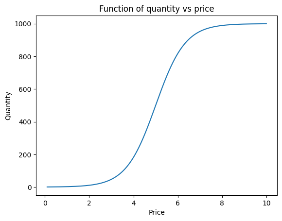


Finding the optimal solution

Let's consider three days, each with a different price/quantity curve, as illustrated below.

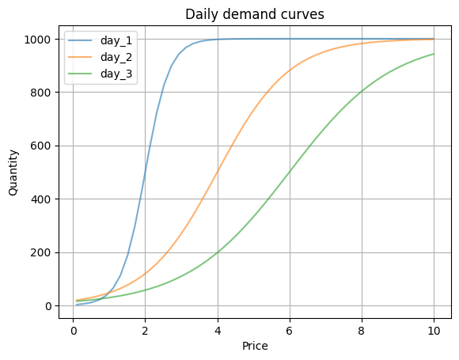


Suppose our target is to purchase 1,700 units. With hundreds of possible price points per day, there could be millions of combinations to evaluate.

This is where Mixed Integer Linear Programming (MILP) becomes useful. Instead of checking every combination individually, it uses mathematical optimization to efficiently identify the lowest-cost solution.

We can formulate the problem using Python's PuLP library:

- Objective: Minimize total purchasing cost.
- Constraint 1: Select at most one price/quantity option per day.
- Constraint 2: Deliver at least 1,700 units in total.

Binary decision variables indicate whether each purchasing option is selected (1) or not (0).


```python
from pulp import LpProblem, LpMinimize, LpVariable, lpSum, LpBinary, LpStatus, value
model = LpProblem("daily_bid_optimization", LpMinimize)

z = {
        oid: LpVariable(f"z_{oid}", cat=LpBinary)
        for oid in option_ids
    }

# objective: minimize total cost
model += lpSum(
    row.cost * z[row.option_id]
    for row in options_df.itertuples(index=False)
)

# at least one option per day
for day in options_df["day"].unique():
    day_option_ids = options_df.loc[options_df["day"] == day, "option_id"].tolist()
    model += lpSum(z[oid] for oid in day_option_ids) <= 1, f"one_option_{day}"

# total quantity must meet target
model += lpSum(
    row.qty * z[row.option_id]
    for row in options_df.itertuples(index=False)
) >= target_qty, "target_quantity"

model.solve()
```

Optimization results

The optimizer identifies the following purchasing strategy:


```text
Status: Optimal
Total qty: 1700.1
Total cost: 5876.8

   day    price qty    cost
0  day_1  2.75  906.8  2501.51
1  day_2  4.18  546.6  2288.63
2  day_3  4.40  246.6  1086.71
```

The total cost is approximately $5,877, with 1,700 units delivered.

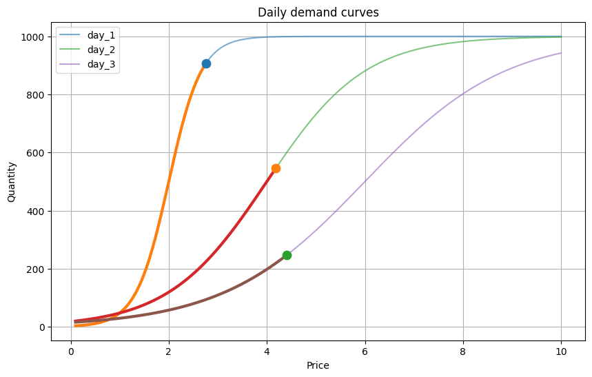


The interesting result is that the optimizer purchases different quantities at different prices across the three days. It accounts for the entire price/quantity relationship rather than simply selecting the lowest available prices.

The key takeaway: MILP allows us to find the globally optimal purchasing strategy without exhaustively testing every possible combination. This becomes particularly valuable as the number of days, segments, and purchasing options increases.


<br>
<br>

## 3. Predicting Future Price/Quantity Curves


The optimization algorithm requires price/quantity curves for each day of the planning period. But how can we estimate these curves for future dates when market conditions are constantly changing?

One approach is to estimate a baseline curve and adjust it using forecasts of future market conditions. This is particularly useful when historical data is limited or building a complex predictive model is impractical.

### Estimating the Baseline Curve

There are three possible approaches:

1. Historical averages: Estimate the curve from past observations. This is relatively simple but assumes historical relationships remain relevant.

2. Predictive modeling: Train a model to estimate price/quantity relationships based on market conditions and other factors. Potentially more flexible, but requires sufficient training data.

3. Experiments during execution: Test different prices and observe the resulting quantities. This provides information about current market conditions but can be expensive and depends on auction restrictions.

For the simpler approach, we can use either historical averages or experimental observations to estimate a baseline curve.

### Making the Curve Transferable Across Days

The same price will not necessarily deliver the same quantity on different days. Both total market volume and average market price can change significantly.

Instead of expressing the curve in absolute terms, we can normalize both variables:

- Price: Expressed as a multiple of the average market price.
- Quantity: Expressed as a percentage of total market volume.

<br>

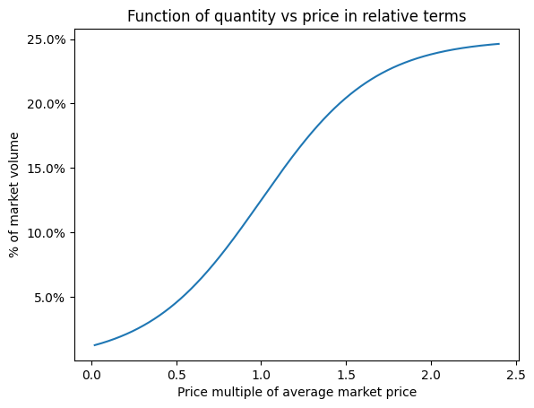


This normalization makes the curve transferable across days with different market conditions.

For example, if the baseline curve indicates that bidding 1.5 times the average market price delivers 20% of available volume, we can use that relationship with forecasts of future market prices and volumes to estimate actual prices and quantities.

### Accounting for Seasonality

Seasonality is common in many business processes and can be an important source of predictable variation. Ignoring it can lead to inaccurate forecasts, while incorporating it is often relatively straightforward using time series models.

Market volume and average market price may follow monthly, weekly, or holiday-related patterns. We can forecast these variables separately and use their predicted values to adjust our baseline curve for each future day.

To illustrate, let's look at daily electricity demand in California.

<br>

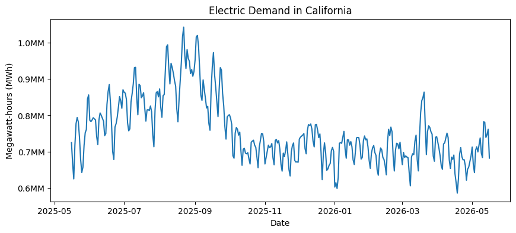

Electricity demand exhibits clear seasonal patterns, with higher consumption during summer months and lower consumption during winter. A time series model such as Meta's Prophet can help identify and forecast these patterns.

The following charts illustrate yearly and weekly seasonality estimated from the historical data.

<br>

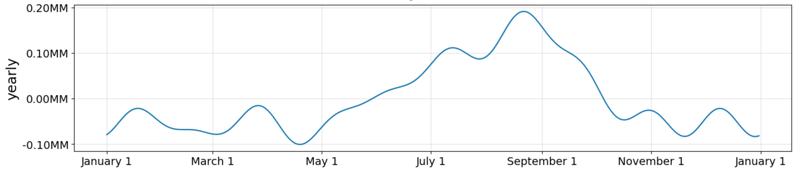


<br>

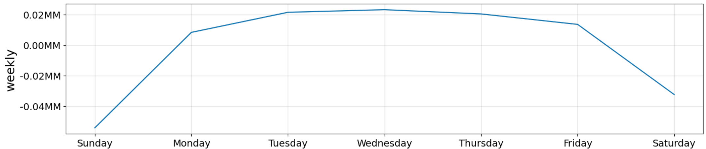


The weekly pattern is particularly interesting: Sunday had the lowest electricity demand in 40 of the observed weeks, while Saturday was lowest in another 8 weeks.


<br>


::: {.columns}

::: {.column width="50%"}
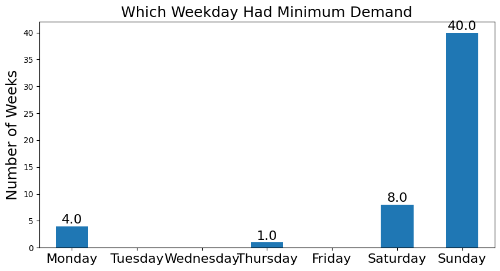{width=100% height=300px}
:::

::: {.column width="50%"}
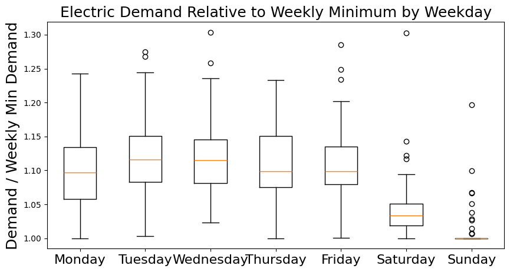{width=100% height=300px}
:::

:::


Of course, not all variation is predictable. For example, unusually hot days can produce unexpected spikes in electricity demand. Also, one year of historical data is insufficient to reliably estimate annual and holiday effects.

### Putting Everything Together

Once we have a baseline relative price/quantity curve and daily forecasts of market volume and average price, we can convert the relative curve into an absolute curve for each future day.

This gives the optimizer the inputs it needs to determine the lowest-cost purchasing strategy across the planning period.

The key takeaway: Rather than predicting a completely new curve for every future day, we can combine a normalized baseline curve with relatively simple time series forecasts. This allows us to account for seasonality and changing market conditions without necessarily building a complex predictive model.


<br>
<br>

## 4. Why Segmentation Matters in Optimization


Imagine a company wants to purchase one million advertising impressions on social media. It can target different audiences, such as young adults, families, or professionals.

Although the product being purchased is the same — advertising impressions — each audience may have a different relationship between bidding price and available quantity.

The company could purchase impressions using a single bidding strategy across all audiences or divide them into segments and optimize bids separately.

Why might segmentation reduce the total cost of reaching the same impression target?

To answer this question, we first need to understand incremental cost.

### Understanding Incremental Cost

As discussed earlier, purchasing more impressions requires increasing the bidding price. An important assumption in our example is that the higher price applies to all purchased impressions, not just the additional ones.

Let's consider two purchasing options:

- Option 1: Purchase 200 impressions at $4 each, for a total of $800.
- Option 2: Increase the price to $4.73 and purchase 400 impressions, for a total of $1,892.

<br>

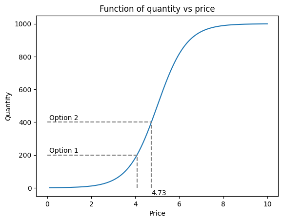


At first glance, it might seem that the additional 200 impressions cost $4.73 each. However, increasing the price also increases the cost of the original 200 impressions.

<br>

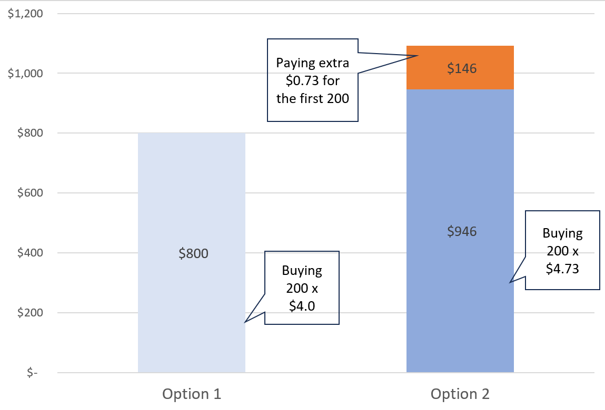


The additional cost consists of two components:

- $946 to purchase 200 additional impressions at $4.73.
- $146 in additional spending on the original 200 impressions because their price increased from $4 to $4.73.

Therefore, the incremental cost per additional impression is:

<br>
$$
\text{Incremental Cost} = \frac{1892-800}{400-200} = $5.46
$$

The important insight is that incremental cost can be significantly higher than the actual bidding price. This distinction is essential for understanding how the optimizer allocates purchases across different opportunities.

<br>

### How Incremental Cost Determines the Optimal Allocation

Let's return to our three-day optimization example from Section 2.

Previously, we calculated the optimal strategy for purchasing 1,700 units. Now suppose we increase the target to 2,000 units.


::: {.columns}

::: {.column width="50%"}

```text

Old target
Status: Optimal
Total qty: 1700.1
Total cost: 5876.8

   day    price qty    cost
0  day_1  2.75  906.8  2501.51
1  day_2  4.18  546.6  2288.63
2  day_3  4.40  246.6  1086.71
```

:::

::: {.column width="50%"}

```text

New target
Status: Optimal
Total qty: 2000.0
Total cost: 7985.4

   day    price qty    cost
0  day_1  2.87  932.9  2684.57
1  day_2  4.68  664.4  3111.36
2  day_3  5.43  402.7  2189.48


```

:::

:::


<br>

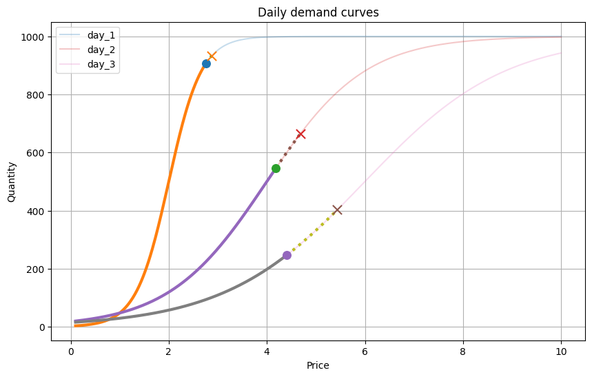


Interestingly, the optimizer allocates the additional 300 units very differently across the three days.

Although Day 1 has the lowest bidding price, it receives the smallest increase in purchased quantity.

The reason becomes clear when we calculate the incremental costs:

<br>
$$
\begin{aligned}
\text{Day 1: } & \frac{2684-2501}{932-906} \approx $7.04\ \\[8pt]
\text{Day 2: } & \frac{3111-2288}{664-546} \approx $6.97\ \\[8pt]
\text{Day 3: } & \frac{2189-1086}{402-246} \approx $7.07
\end{aligned}
$$

Despite the differences in bidding prices, the incremental costs are almost identical.

This illustrates an important optimization principle: when allocating additional quantity across continuous, convex cost curves, the optimal solution tends to equalize incremental costs.

Purchasing more on Day 1 would increase its incremental cost beyond that of the other days, making the overall solution more expensive.

### Why Segmentation Can Reduce Costs

Now let's return to our social media advertising example.

Suppose different audience segments have substantially different price/quantity curves.

If we combine them into a single purchasing group, we lose the ability to choose different bids for each audience. This can force us to pay unnecessarily high prices for impressions that could have been purchased more cheaply.


<br>

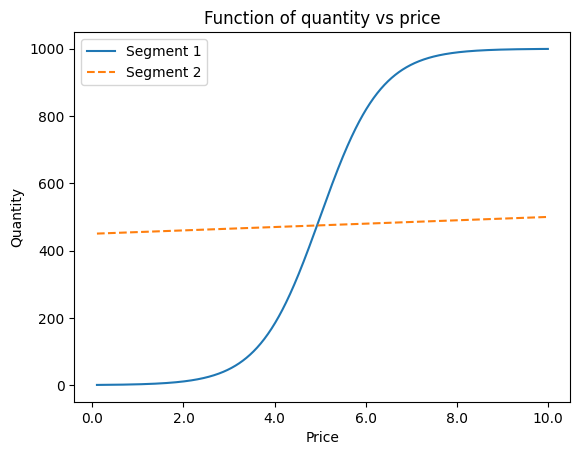


In this example, Segment 2 has a nearly flat curve: increasing the bidding price produces very little additional quantity.

It would therefore make sense to purchase impressions from this segment at a relatively low price while using higher bids for Segment 1, where additional spending can produce significantly more impressions.

By optimizing the segments separately, we gain the flexibility to allocate spending according to their different incremental costs.

However, creating too many segments also increases complexity. Ideally, we want to group purchasing opportunities that behave similarly without sacrificing optimization efficiency.

### When Can Segments Be Grouped Together?

The next question is how to determine whether two segments are similar enough to combine.

We can answer this mathematically.


Let $$q(p)$$ represent the quantity delivered at price $$p$$

Since the total cost is:

$$
C(p)=p\cdot q(p)
$$

The incremental cost of obtaining one additional unit is:

$$
IC(p)=\frac{dC}{dq}=p+\frac{q(p)}{q'(p)}
$$

This formula shows that incremental cost depends on both the current price and the shape of the price/quantity curve.

An interesting result follows: two curves have identical incremental costs at every price if they differ only by a constant scaling factor.

In other words:

$$
q_2(p)=K\cdot q_1(p)
$$

where $$K$$ is a constant.

For example, if one audience segment consistently delivers twice as many impressions as another at every bidding price, their curves have the same shape and identical incremental costs at corresponding prices.

Under the assumptions of our model, these segments can be combined without losing optimization efficiency.


<br>

<details>
<summary style="font-size: 22px; font-weight: bold;">
Mathematical Derivation
</summary>

<br>

Incremental cost is the cost of getting one additional unit

$$
IC(p)
=
\frac{dC}{dq}
$$


According to the chain rule

$$
IC(p)
=
\frac{\frac{dC}{dp}}
     {\frac{dq}{dp}}
$$


Since $C(p) = p \cdot q(p)$ we get

$$
\frac{dC}{dp}
=
q(p)
+
p \cdot q'(p)
$$

<br>

and

$$
\frac{dq}{dp}
=
q'(p)
$$

<br>

Therefore

$$
IC(p)
=
\frac{
q(p)
+
p \cdot q'(p)
}
{
q'(p)
}
$$

<br>

Simplifying

$$
IC(p)
=
p
+
\frac{q(p)}
     {q'(p)}
$$

<br>

This means incremental cost depends on both the current price $p$ and the ratio of current quantity to slope

$$
\frac{q(p)}
     {q'(p)}
$$

<br>

Now consider two demand curves: $q_1(p)$ and $q_2(p)$


They have the same incremental cost at price $p$ if:

$$
IC_1(p)
=
IC_2(p)
$$

<br>

Using the formula above:

$$
p
+
\frac{q_1(p)}
     {q_1'(p)}
=
p
+
\frac{q_2(p)}
     {q_2'(p)}
$$

<br>

The price term $p$ cancels out:

$$
\frac{q_1(p)}
     {q_1'(p)}
=
\frac{q_2(p)}
     {q_2'(p)}
$$


<br>

So two curves have the same incremental cost when current quantities divided by their slopes are the same. The general solution is that the two curves differ only by a constant scaling factor:

$$
q_2(p)
=
K \cdot q_1(p)
$$


Differentiating both sides:

$$
q_2'(p)
=
K \cdot q_1'(p)
$$

<br>

And plugging this into the incremental-cost condition:

$$
\frac{q_2(p)}
     {q_2'(p)}
=
\frac{K \cdot q_1(p)}
     {K \cdot q_1'(p)}
$$

<br>

The constant $K$ cancels out:

$$
\frac{q_2(p)}
     {q_2'(p)}
=
\frac{q_1(p)}
     {q_1'(p)}
$$

<br>

Therefore, scaled curves have the same incremental cost at every price:

$$
IC_1(p)
=
IC_2(p)
$$
</details>


<br>


### Key Takeaway

Segmentation is not simply about dividing a market into smaller groups. It is about identifying purchasing opportunities with different incremental cost behavior.

Segments with substantially different price/quantity curves may benefit from separate optimization, while segments whose curves differ only by scale can be grouped together.

This provides a mathematical foundation for designing segments that improve cost efficiency without introducing unnecessary complexity.


<br>
<br>

## 5. Conclusion

This project demonstrates how mathematical optimization can help identify the most cost-effective purchasing strategy when prices, quantities, and available options vary.

While the initial example was relatively simple, the same approach can be extended to more realistic business scenarios by incorporating demand forecasting, market segmentation, and different pricing relationships.

The broader takeaway is that predictive modeling and optimization complement each other: forecasting helps estimate what is likely to happen, while optimization helps determine the best decisions to make based on those estimates.