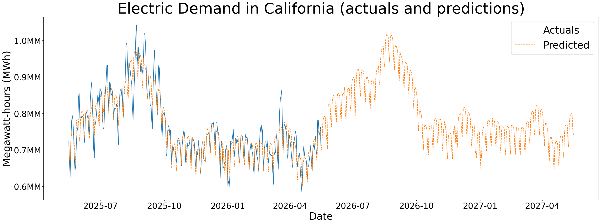

<br>

### 1. Introduction

In this project I want to show linear programming algorithm which can be applied to different business problems. It’s very powerful tool which can solve cost optimization or profit maximization objectives among others and has been around since mid of 20th century. In particular, it can be used to answer a question: given known increasing functions of quantity per cost for multiple products/segments what would be the most optimal combination of quantity and cost for each product that would allow to reach a certain level of overall delivery with the lowest expense.


<br>

### 2. Example of how to use linear programming for optimization
Let’s review a simple example of how it can be used. The goal is to deliver X amount of goods over N days at minimum cost by participating in an auction. The demand curve is an increasing function of price. We can make a valid assumption that delivering a larger quantity requires that an increased price is applied uniformly to all units rather than using a tiered pricing structure where the first units are purchased at lower price p1, the next set at p2 and so on. It's also reasonable to assume that the demand curve should be eventually flattening as cost continues to increase. Something like on this picture below:


If we have some knowledge about how the demand curve is going to look like for each of those 3 days we can use this information and apply linear programming to calculate quantity/price combination for each day to achieve this target.


Here, PuLP is a python library for optimization problems. LpMinimize is a function to set the objective of cost minimization.
```python
from pulp import LpProblem, LpMinimize, LpVariable, lpSum, LpBinary, LpStatus, value
model = LpProblem("daily_bid_optimization", LpMinimize)
```

We are going to use MILP (mixed integer linear programming) due to the fact that we have a binary variable to determine whether we are participating in the auction on a given day or not. And if we are then we can choose only one option. For example, bid at this price to get this quantity vs bid at multiple prices on the same day. Binary variable z is to indicate participation or not and price point.
```python
z = {
        oid: LpVariable(f"z_{oid}", cat=LpBinary)
        for oid in option_ids
    }
```


Next step is to set up the objective and constraints. The objective is to minimize total cost. The first constraint is that we can only choose one option per day. The second constraint is that the total quantity delivered across all days must meet or exceed the target quantity.
```python
# objective: minimize total cost
model += lpSum(
    row.cost * z[row.option_id]
    for row in options_df.itertuples(index=False)
)

# exactly one option per day
for day in options_df["day"].unique():
    day_option_ids = options_df.loc[options_df["day"] == day, "option_id"].tolist()
    model += lpSum(z[oid] for oid in day_option_ids) <= 1, f"one_option_{day}"

# total quantity must meet target
model += lpSum(
    row.qty * z[row.option_id]
    for row in options_df.itertuples(index=False)
) >= target_qty, "target_quantity"

model.solve()
```

Let's assume these are 3 demand curves for 3 days mentioned before. I can explain later how to build them.


The only thing to provide to the optimizer now is the target quantity. In this case, I set it to 1700. LpStatus function will translate the status of the optimization. The output of the optimization will be the price/quantity combination for each day that allows to reach this target at minimum cost. As it's shown below, the optimal solution is to bid at $2.75 for 906 units on day 1, $4.18 for 546 units on day 2 and $4.40 for 246 units on day 3. The total delivery will be 1707 - slighty above the target.

```text
Status: Optimal
Total qty: 1700.1280794905174
Total cost: 5876.858169147138

     day     price         qty         cost
0  day_1  2.758517  906.831849  2501.511102
1  day_2  4.186974  546.607785  2288.632555
2  day_3  4.405210  246.688446  1086.714512
```


This is the best solution out of all possible combinations of price/quantity for each day. Linear programming algorithm helps to find this optimal solution without testing all combinations. The number of all possible combinations grows exponentially with the number of days and price points. Without linear programming this task could be computationally infeasible to solve in a reasonable time frame.


<br>
<br>

### 3. Why seasonality matters and how to calculate price/quantity relationship on relative basis
Going back to the question on how to build a demand curve for each day. There are external factors such as total market volume and average market price for a specific product which needs to be taken into account. This means we can't expect to get the same quantity delivered for the same price across all days.

There could be a seasonal pattern to those 2 factors - total market volume and average market price. For example weekday and weekends may have differ as well as holidays. If total market volume increases during weekends and average prices stay the same then we can expect to deliver more at the same price and so on. We can utilize this information to adjust demand curves based on prior knowledge about the market - how volume and prices are expected to change over time. Simple time series forecasting can be used to predict future values based on historical data.

Unfortunately I couldn't find any public data on some type of market that can be used as an example here. But i have one for electricity demand in California. It shows daily data from May 2025 to May 2026. There is definitely an increasing trend during summer months and a lot of volatility. 

<br>


A time series model can help to break down monthly, weekly, etc seasonality if there is any. For example Meta's Prophet model can be easily applied here. I have weekly, monthly, quartely, yearly seasonality as well as US holidays effects. Of course 1 year of data can't give us good estimate of yearly seasonality or holiday impact. But yearly seasonality does make sense here as demand is expected to be higher during summer months and lower during winter months like in the chart below.

<br>


It's interesting to note that the model suggest strong weekly seasonality as well. Which also makes sense as demand is going down during weekends.

<br>


I double checked whether Saturdays and Sundays were in fact the days with minimum demand in each respective week. It turned out that in 40 cases Sunday was the day with the lowest demand and in 8 cases it was Saturday.

<br>


::: {.columns}

::: {.column width="50%"}
{width=100% height=300px}
:::

::: {.column width="50%"}
{width=100% height=300px}
:::

:::

As with any data there is some specifics to it. I have noticed that some days have abnormally high demand which coincided with extremely hot weather in California. This can't be predicted so it's important to keep this in mind when working on a business problem.


With this knowledge we can build demand curves that would work on any day if we provide a forecast of market volume and average price. And as it was mentioned before, there is often some significant seasonality which continues into the future and can be predicted with decent accuracy. Instead of absolute price/quantity relationship it should be expressed in relative terms - what percent of total market volume can be delivered at a given price multiple of average market price. Something like this:

<br>


Such forecast can be produced with a time series model. For example here is what i have for the next 365 days of electric demand in California just using weekly, yearly and holiday seasonality.

<br>




<br>

Now after we have taken care of this important detail let's think about how to build the curve itself. There are a few options:

1. **Build a curve using some historical averages taking into account seasonality of total market volume and average price**
    <br>*<u>Pros</u>*:
    - easy solution if data is available

    *<u>Cons</u>*:
    - may not be applicable to future predictions if past and future are not similar enough. For example products are different, market conditions have changed, etc

<div style="margin-top:20px;"></div>

2. **Build a predictive model**
    <br>*<u>Pros</u>*:
    - can fix issues with the first approach

    *<u>Cons</u>*:
    - requires a lot more data to address differences between past and future
    - may still be not accurate enough if there are more external factors to take into account and they are not reflected in the data

<div style="margin-top:20px;"></div>

3. **Run a random experiment and build the curve during execution**
    <br>*<u>Pros</u>*:
    - the most accurate approach as it is based on observations of the performance in the current market conditions
    
    *<u>Cons</u>*:
    - may be expensive
    - depends on specific auction and its restrictions


<br>
<br>

### 4. Segmentation is the most important part in the optimization

Once demand curves are predicted/estimated there is another important step - segmentation.

In order to understand how to properly do it, let's introduce the concept of incremental cost. We already made an assumption that in order to deliver a larger quantity, increased price shoud be applied uniformly to all units rather than using a tiered pricing structure. 

It means that if we can deliver x1 quantity at price p1 then to deliver x2 we need to pay p2 price for not just additional x2-x1 volume but for all x2. Increamental cost per unit of extra x2-x1 volume is 

<br>

$$
\text{Incr cost per unit}
=
\frac{p_2 * x_2 - p_1 * x_1}{x_2 - x_1}
$$

If there are multiple demand curves we can use to deliver the target quantity then the optimization algorithm would select the one with the lowest incremental cost per unit at each point.

Let's take our previous example and increase the target quantity from 1700 to 2000 units. 


::: {.columns}

::: {.column width="50%"}

```text

Old target
Status: Optimal
Total qty: 1700.1280794905174
Total cost: 5876.858169147138

     day     price         qty         cost
0  day_1  2.758517  906.831849  2501.511102
1  day_2  4.186974  546.607785  2288.632555
2  day_3  4.405210  246.688446  1086.714512
```

:::

::: {.column width="50%"}

```text

New target
Status: Optimal
Total qty: 2000.044288652825
Total cost: 7985.415009549276

     day     price         qty         cost
0  day_1  2.877555  932.934506  2684.570454
1  day_2  4.682966  664.400341  3111.364161
2  day_3  5.436874  402.709442  2189.480394


```

:::

:::


We already saw that the most optimal approach to deliver 1700 units was to buy 906 units at $2.75 each on day 1, 546 units at $4.18 each on day 2, and 246 units at $4.40 each on day 3. This is our starting point. Optimization results for the new target suggest that on day 1 we should only buy 26 more units - 932 in total at $2.88 each. While day 2 amount goes from 546 to 664 units at $4.68 each. And the biggest increase is on day 3, where the amount goes from 246 to 402 units at $5.43 each.


<br>


Interesting finding here is that even though bidding price on day 1 is the lowest but the optimization suggest we should be bying least amount on that day compared to other days when the bidding price is higher. The reason for that is the incremental cost. As you can see its about the same for these amounts.

$$
\text{Incr Cost Day 1}
=
\frac{2684 - 2501}{932 - 906}
=
\frac{183}{26}
=
7.04
$$

$$
\text{Incr Cost Day 2}
=
\frac{3111 - 2288}{664 - 546}
=
\frac{823}{118}
=
6.97
$$

$$
\text{Incr Cost Day 3}
=
\frac{2189 - 1086}{402 - 246}
=
\frac{1103}{156}
=
7.07
$$


If we buy more on day 1 the inremental cost for that will be higher and we will end up paying more for the additional units vs buying on other days. So even lower bid point may have higher incremental cost based on its demand curve and that's all what matters.


Why incremental cost is important for optimization efficiency? Let's say we have 2 segments with very different demand curves. If we combine them together and try to optimize, the algorithm would be forced to take suboptimal solution by applying similar treatment to both. But if we separate them and optimize each segment independently we can see that price and quantity will be very different. For example in the below chart segment 2 demand curve has very extreme shape - almost horizontal just to articulate the point. In such a case it's best to choose very low buying price for that segment cause quantity will not be much different vs bying this segment at a higher price. Combining them both would result in waste of money.


<br>


Based on this observation we should be creating segments by aggregating units with similar incremental costs across relevant bying points. It's infeasible to have a separate segment for each unit so such segmentation strategy allows to minimize inefficiencies highlighted above.

The next question is how to determine whether two curves have similar incremental cost and can be grouped together without losing optimization efficiency. Let's try to answer this question by looking at the math behind incremental cost.

<br>

Let's define a demand curve: $q(p)$

where:

- $p$ - price
- $q(p)$ - quantity delivered at price $p$


Slope of the curve at price $p$ or the first derivative is $q'(p)
=
\frac{dq}{dp}
$ and total cost is $C(p) = p \cdot q(p)$


Incremental cost is the cost of getting one additional unit

$$
IC(p)
=
\frac{dC}{dq}
$$


According to the chain rule

$$
IC(p)
=
\frac{\frac{dC}{dp}}
     {\frac{dq}{dp}}
$$


Since $C(p) = p \cdot q(p)$ we get

$$
\frac{dC}{dp}
=
q(p)
+
p \cdot q'(p)
$$

<br>

and

$$
\frac{dq}{dp}
=
q'(p)
$$

<br>

Therefore

$$
IC(p)
=
\frac{
q(p)
+
p \cdot q'(p)
}
{
q'(p)
}
$$

<br>

Simplifying

$$
IC(p)
=
p
+
\frac{q(p)}
     {q'(p)}
$$

<br>

This means incremental cost depends on both the current price $p$ and the ratio of current quantity to slope

$$
\frac{q(p)}
     {q'(p)}
$$

<br>

Now consider two demand curves: $q_1(p)$ and $q_2(p)$


They have the same incremental cost at price $p$ if:

$$
IC_1(p)
=
IC_2(p)
$$

<br>

Using the formula above:

$$
p
+
\frac{q_1(p)}
     {q_1'(p)}
=
p
+
\frac{q_2(p)}
     {q_2'(p)}
$$

<br>

The price term $p$ cancels out:

$$
\frac{q_1(p)}
     {q_1'(p)}
=
\frac{q_2(p)}
     {q_2'(p)}
$$


<br>

So two curves have the same incremental cost when current quantities divided by their slopes are the same. The general solution is that the two curves differ only by a constant scaling factor:

$$
q_2(p)
=
K \cdot q_1(p)
$$


Differentiating both sides:

$$
q_2'(p)
=
K \cdot q_1'(p)
$$

<br>

And plugging this into the incremental-cost condition:

$$
\frac{q_2(p)}
     {q_2'(p)}
=
\frac{K \cdot q_1(p)}
     {K \cdot q_1'(p)}
$$

<br>

The constant $K$ cancels out:

$$
\frac{q_2(p)}
     {q_2'(p)}
=
\frac{q_1(p)}
     {q_1'(p)}
$$

<br>

Therefore, scaled curves have the same incremental cost at every price:

$$
IC_1(p)
=
IC_2(p)
$$


<br>


So if two segments have demand curves that differ only by scale they can be grouped together without losing optimization efficiency. Since the incremental cost will be the same for both segments at every price point, so the optimizer will make the same decisions for both segments regardless of how they are grouped.